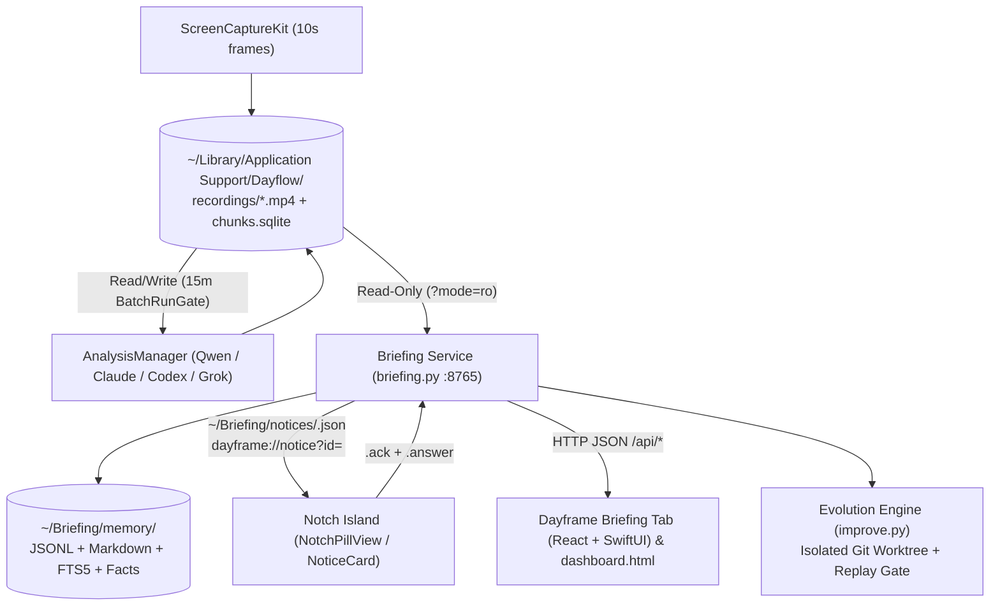

# 01 — Product Understanding

## 1. Product Thesis (Observed)
Dayframe is a privacy-first, local-first macOS personal work journal and workspace orchestrator forked from Dayflow v2.6.0 (`1df9be4`, MIT). It serves a single Mac owner by continuously capturing the screen every 10 seconds into 10-minute video chunks, synthesizing activity every 15 minutes into an ordered timeline of cards using local AI (`qwen3.5:4b` on Ollama) or subscription CLI agents (`claude`, `codex`, `grok` — never paid API keys), and turning that history into morning-to-evening briefings, durable cited memory, a hardware-notch liquid island ("Jarvis"), and an automated Start-of-Day workspace setup.

## 2. Capability Map

| Capability | Primary Files | Dependencies | Permissions | Maturity |
|---|---|---|---|---|
| **Screen Recording & Watchdog** | `App/Dayflow/Core/Recording/ScreenRecorder.swift`, `App/Dayflow/App/RecordingWatchdog.swift`, `Keepalive/local.dayframe.keepalive.plist` | `ScreenCaptureKit`, `SQLite.swift` (`chunks.sqlite`) | Screen Recording (`tccd`, tied to `identifier "local.dayframe.app"`) | Production (`Verified`) |
| **Timeline Batch Analysis & Chat** | `App/Dayflow/Core/Analysis/AnalysisManager.swift`, `OllamaProvider*.swift`, `ClaudeProvider*.swift`, `CodexProvider*.swift`, `GrokProvider*.swift`, `DashboardChatTools.swift` | Local Ollama (`127.0.0.1:11434`) or CLI binaries (`claude`, `codex`, `~/.grok/bin/grok`) | Local subprocess / loopback HTTP | Production (`Verified`; Grok live run awaits user `grok login`) |
| **Notch Island & Quiet Peek Notices** | `App/Dayflow/Island/IslandController.swift`, `NotchPillView.swift`, `BriefingNotice.swift`, `IslandShowPanel.swift` | `WKWebView` (WebGL goo show), `~/Briefing/notices/` | None (excluded from capture via `IslandCaptureExclusion`) | Production (`Verified`; extended with `.resume` in v1.3) |
| **Start of Day & Welcome Show** | `App/Dayflow/Welcome/WelcomeController.swift`, `StartOfDay.swift`, `WindowSlot.swift`, `FocusShortcut.swift`, `WallpaperManager.swift`, `AppIconArt.swift` | `CGSSessionUniqueSessionUUID`, Accessibility API, `/usr/bin/shortcuts` | Accessibility (for window placement), Shortcuts (`Work Focus`) | Production (`Verified`) |
| **Briefing Service & Memory** | `Briefing/briefing.py`, `Briefing/dashboard.html`, `App/Dayflow/Views/UI/Briefing/BriefingView.swift`, `Web/src/briefing/briefing-page.tsx` | Python 3 stdlib, `chunks.sqlite` (`?mode=ro`), `~/Briefing/memory/` | Owner-only `0700`/`0600` filesystem | Production (`Verified`) |
| **Application Evolution Engine (Evolution Center)** | `Briefing/improve.py`, `Briefing/dashboard.html` (`#improve`), `Briefing/tests/test_improve.py` | Local `git` worktrees, `unittest` suite, held-out replay logs | L0 (`audit`), L0–L1 (`guided`), or Delegated L2 (`controlled_autonomous`) | Production (`Verified`; upgraded in v1.3) |

## 3. Workflow Graph & Architecture Map

## 4. Evidence & Uncertainty Register
- **Evidence:** Grounded in `AGENTS.md`, `CONTEXT.md`, `START-HERE.md`, `CHANGELOG.md`, `docs/adr/0001`–`0007`, `Briefing/briefing.py`, `Briefing/improve.py`, `App/Dayflow/Island/*`, and `App/Dayflow/Views/UI/Briefing/*`.
- **Uncertainties / Host Dependencies:**
  - Live Grok CLI image flag behavior (`--prompt-json`) remains blocked until the owner runs `~/.grok/bin/grok login` (`Observed` in `.scratch/grok/issues/05-grok-images.md`).
  - macOS TCC permissions (Screen Recording, Accessibility) and Shortcuts (`Work Focus`) are owner-managed outside the repository (`AGENTS.md`).
