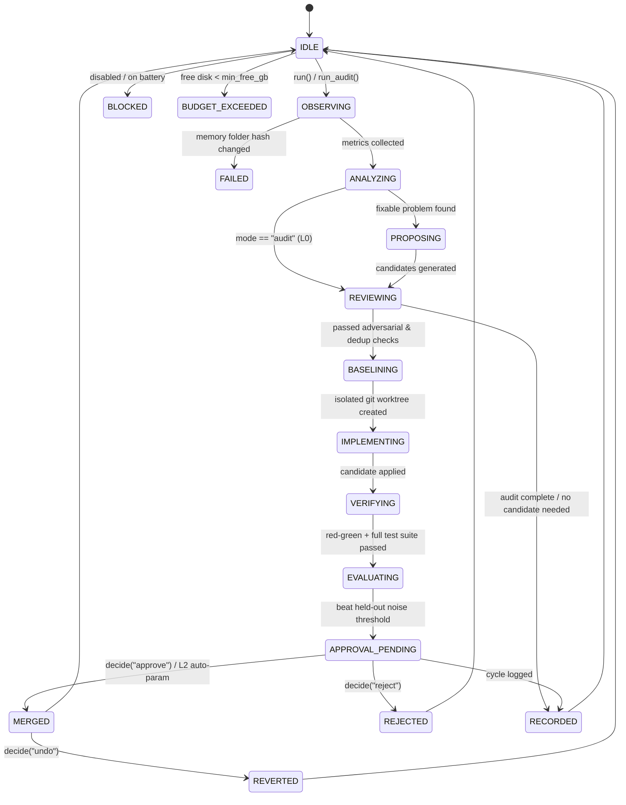

# 08 — Application Evolution Engine Architecture

## 1. Functional Modules (`Briefing/improve.py`)

| Module | Implementation in `Briefing/improve.py` | Responsibility |
|---|---|---|
| **1. Observer** | `metrics(cfg, now)` | Aggregates local-only, content-free telemetry (`~/Briefing/telemetry.jsonl`) across `notch`, `companion`, `nextmove`, `llm` (`p50_ms`, `p90_ms`, `error_rate`), `briefing` (`down_rate`), `automation`, and `errors`. |
| **2. Codebase Indexer** | `index_codebase(cfg)` | Builds a live map of repository modules, unit test suites (`tests/test_*.py`), git readiness, and locked governance boundaries (`PROTECTED_FILES`, `PROTECTED_FUNCS`). |
| **3. Opportunity Detector** | `problems(cfg, m)` | Detects actionable friction and quality regressions, computing `confidence`, `effort`, `risk`, and `priority = (value × confidence × urgency) / (effort × risk)`. |
| **4. Planner** | `iteration_contract(cfg, mode, problem, cand)` | Produces a bounded contract specifying objective, authority level (`L0`, `L0-L1`, `Delegated L2`), allowed/protected files, diff budgets, and rollback command. |
| **5. Adversarial Reviewer** | `check_patch(cfg, patch, repo)`, `is_duplicate_rejected(cand, mode)` | Rejects any patch that touches `PROTECTED_FILES` / `PROTECTED_FUNCS`, removes error/privacy checks (`SAFETY_NET_RE`), adds `FORBIDDEN_TOKENS`, exceeds `improve_max_net_growth`, or repeats an already-rejected proposal. |
| **6. Execution Controller** | `MODES`, `current_mode(cfg)`, `run(cfg, force, mode)`, `cancel(cfg)` | Enforces mode permissions (`audit` L0 never creates branches or edits files), battery/disk/lock circuit breakers, and memory-hash invariance (`mem_hash()`). |
| **7. Implementation Worker** | `gate(cfg, cand)` (`git worktree add -b improve/<cid>`) | Applies candidate changes exclusively inside an isolated temporary git worktree. |
| **8. Verifier** | `run_new_tests(wt, paths, env)` + full `unittest` suite | Enforces red-then-green failing-test-first verification (`baseline: "fail" → candidate: "pass"`) and runs the full unit test suite in an isolated `BRIEFING_HOME`. |
| **9. Evaluator** | `judge(cfg, base, cand, label)`, `paired_gain(base, cand)` | Compares held-out replay results against baseline, requiring gain > `max(improve_min_gain, 2 * SE)` and ≤ 5% loss of useful actions. |
| **10. Change Recorder** | `transition(...)`, `props_save(...)`, `runlog(...)`, `decide(...)` | Logs every state transition to `~/Briefing/improve/transitions.jsonl` and `state.json`, creates a pre-merge git bundle (`backups/<id>-before.bundle`), and supports one-click `git revert` (`Undo`). |
| **11. Evolution Center UI** | `Briefing/dashboard.html` (`#improve`) + `BriefingView.swift` / `briefing-page.tsx` | Displays live state machine status, mode selector, Audit-only (L0) & Guided cycle triggers, health metrics, ranked candidate backlog, diffs, and Approve/Reject/Undo controls. |

## 2. State Machine Diagram

